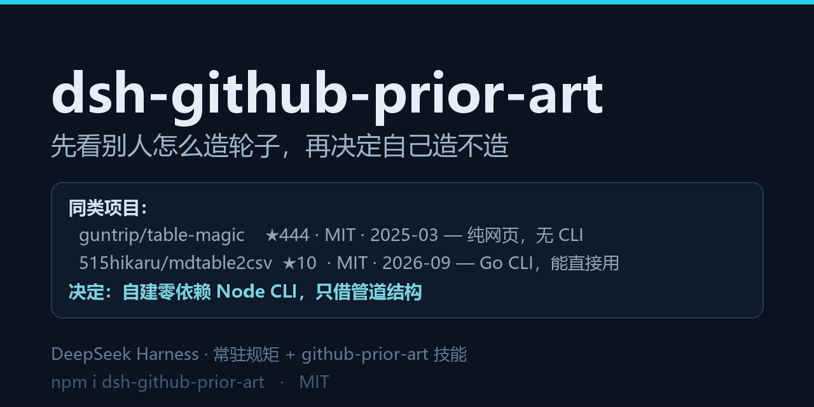

# dsh-github-prior-art

[中文](README.md) · MIT · **0.1.3**

[](https://www.npmjs.com/package/dsh-github-prior-art)
[](https://www.npmjs.com/package/dsh-github-prior-art)
[](https://github.com/deepseek-ai/deepseek-harness)
[](LICENSE)

**A standing rule for DeepSeek Harness: before building X from scratch, look at who already built X on GitHub.**

The most expensive waste an agent commits is not a wrong line of code — it is re-inventing a wheel someone has maintained for three years, and doing it worse. With this plugin installed, every "build me an X" starts with one bounded search round (≤3 minutes) over 3–5 comparable projects, and ends with three lines: candidates, decision, reason.

**Install**: open **Plugins** in the DSH sidebar → **Add plugin** → paste the line below → **Install**:

```
dsh-github-prior-art@0.1.3
```

---

## 🤔 Why

- **Re-inventing is the default.** The model does not know what is already installed on your machine, or that someone solved the same problem two years ago. Without a prompt, it starts from zero.
- **"I'll search first" does not survive a restart.** A note in `AGENTS.md` is per-machine and per-session; a plugin carries the rule with the install.
- **A search without a written conclusion is not a search.** The rule forces three lines — candidates, decision, reason — so the work is visible and reviewable.

## ✨ What you get

| | |
|---|---|
| **Always-on rule** (~6 lines, every request) | When to search, when not to, and what must be written before coding |
| **`github-prior-art` skill** (loaded on demand) | The full procedure: 2–3 query groups, five dimensions per candidate, depend / fork / borrow-structure / build priority, anti-patterns |
| **Your `AGENTS.md` is untouched** | The rule travels through `systemPrompt.section`, the skill through `skills.register`; uninstall restores the previous behaviour |
| **Never stuck** | No `gh_*` tools or no token? Falls back to `web_search site:github.com`; no high-relevance hit after one round means build it — and say why |
| **Quiet on small work** | Bug fixes, small edits, config and docs are exempt; "don't bother searching" is honoured and noted |

## 🚀 Install

### In the DSH UI (recommended)

**Plugins** → **Add plugin** → search `dsh-github-prior-art` → **Install**. Refresh the page; the rule and the skill are live. No config file is edited.

### CLI (install from npm)

The package is on npmjs: [`dsh-github-prior-art`](https://www.npmjs.com/package/dsh-github-prior-art). `dsh plugin` does not resolve names itself — it forwards its arguments to pnpm (a `pnpm add` inside that profile directory), so a bare package name means "install the latest from the registry":

```sh
# latest (writes ^0.1.3 into the profile's package.json)
dsh plugin --profile desktop add dsh-github-prior-art

# pin an exact version
dsh plugin --profile desktop add dsh-github-prior-art@0.1.3
```

The profile's `package.json` gets the dependency and `dsh.profile.bundles` gains `dsh-github-prior-art`; host-side plugins load inside the process, so **restart DSH** (a page refresh is not enough).

Two traps:

- Your default registry may be a mirror; a just-published version can lag there. Point pnpm at npmjs for that install:
  `dsh plugin --profile desktop add dsh-github-prior-art --registry=https://registry.npmjs.org`
- Use `add ./dsh-github-prior-art` only to run the latest commit that is not released yet — that links the local folder instead of installing from npm.

### Skill only, no plugin

1. Copy [`skills/github-prior-art/`](skills/github-prior-art/SKILL.md) into `~/.dsh/skills/`.
2. Paste [the six-line rule](README.md#方式-c只装技能不装插件) into `~/.dsh/AGENTS.md`.

> Do not use both paths at once — the rule would be injected twice.

## 🔍 A real round

Task: "write a Node CLI that converts Markdown tables to CSV". What the plugin produces before any code exists:

```
Comparable projects:
- guntrip/table-magic       ★444 · MIT   · 2025-03 — web page only, no CLI
- tomroy/mdtable2csv        ★136 · MIT   · 2024-08 — web page, close feature set
- 515hikaru/mdtable2csv     ★10  · MIT   · 2026-09 — Go CLI, usable but needs Go
- beenotung/table-transform ★0   · BSD-2 · 2026-07 — Node CLI, pulls in xlsx
Decision: build a zero-dependency Node CLI; borrow only the stdin→stdout pipeline shape
Reason: the whole point is zero dependencies — a Go toolchain or xlsx is not worth it for 100 lines
```

Only after those lines is the agent allowed to start.

## ⚙️ How it works

```
index.js                          # host half: injects the rule, registers the skill
cordis.patch.yml                  # bundle patch, referenced by dsh.bundle
skills/github-prior-art/SKILL.md  # the skill body, single source of truth
test/smoke.mjs                    # both services present / absent
```

- Both services are obtained **optionally** through `ctx.get(...)`: a host without `skills` or `systemPrompt` starts fine.
- The skill is registered with `source: 'runtime'`.
- No client half: no DOM changes, no buttons — it shapes what the model does, not what you see.

## 🧰 Dependencies

- **Search tools**: `gh_repo_search` / `gh_repo` / `gh_file` from [`@perrylink/dsh-github`](https://github.com/PerryLink/dsh-github) (needs a GitHub token).
- **Without them**: the skill falls back to `web_search site:github.com <terms>`, then to the npm registry.
- **Zero runtime dependencies**: the plugin installs no npm packages.

## ⚠️ Boundaries

- It is a **prompt-level rule, not a hard gate**: the model may still judge that no search is needed, but it must say so.
- It only sees **public GitHub** — private repos and internal components are out of reach.
- It reads repository metadata and READMEs, not every source file.
- It never generates or edits your project — it owns the pre-work search and the write-up, nothing else.

## 🛠️ Development

```sh
node test/smoke.mjs
```

## 📜 Changelog

See [CHANGELOG.md](CHANGELOG.md).

## 📄 License

MIT © 红一角 (yuanzephyr920-oss)
