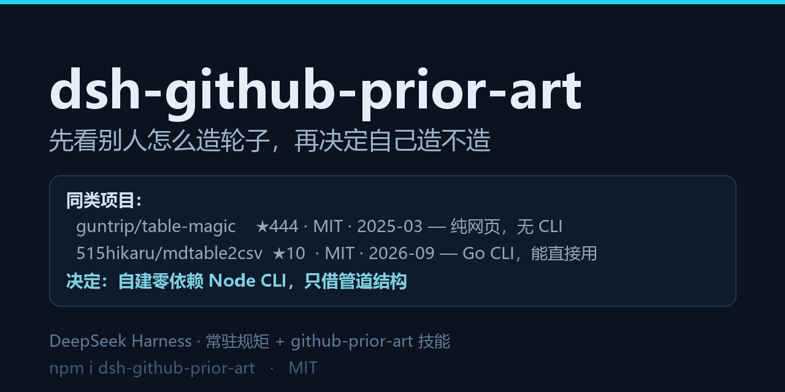

# dsh-github-prior-art

[English](README.en.md) · MIT · **0.1.1**

[](https://www.npmjs.com/package/dsh-github-prior-art)
[](https://www.npmjs.com/package/dsh-github-prior-art)
[](https://github.com/deepseek-ai/deepseek-harness)
[](LICENSE)

**给 DSH 装一条开工前查重的规矩：从零造 X 之前，先看 GitHub 上有没有人已经把 X 造好了。**

Agent 最贵的浪费不是写错代码，是把别人维护了三年的轮子重新发明一遍，还发明得更差。装了这个插件，每次要「从零做个 X」时，它先花一轮时间（≤3 分钟）搜 3–5 个同类项目，把「候选 / 决定 / 理由」写成三行，再决定要不要动手。

**安装**：DSH 侧栏 **Plugins** → **Add plugin**，粘贴下面这一行，点 **Install**：

```
dsh-github-prior-art@0.1.1
```

---

## 🤔 为什么

- **重复造轮是默认行为**。模型不知道你机器上已经装了什么、也不知道两年前有人写过同款，不提示就会从零开始写。
- **"先搜一下"不能靠自觉**。写在 AGENTS.md 里，换个会话、换台机器就没了；写成插件，规矩跟着安装走。
- **搜了不写结论等于没搜**。所以规矩强制落笔：候选是谁、决定是什么、为什么——三行，缺一行就是没做。

## ✨ 装完会发生什么

| | 你得到什么 |
|---|---|
| **常驻规矩**（约 6 行，每个请求都在） | 什么时候必须搜、什么时候不用搜、搜完必须写出什么 |
| **`github-prior-art` 技能**（按需加载） | 完整流程：2–3 组关键词怎么下、候选看哪五个维度、依赖 / fork / 借结构 / 自建怎么排优先级、反面清单 |
| **不改你的 `AGENTS.md`** | 规矩走 `systemPrompt.section`，技能走 `skills.register`；卸载即恢复原样，不留痕迹 |
| **查不到也不卡住** | 没有 `gh_*` 工具或没有 token 时退回 `web_search site:github.com`；一轮没有高相关就自建，并写明原因 |
| **不打扰简单任务** | 修 bug、小改、既有代码续写、配置与文档不触发；你说「别搜了」它跳过并注明 |

## 🚀 安装

### 方式 A：DSH 面板（推荐）

左侧 **Plugins** → **Add plugin** → 搜索 `dsh-github-prior-art` → **Install**。装完刷新页面即可，常驻规矩与技能自动生效，无需改任何配置文件。

### 方式 B：npm / CLI

包已发布到 npmjs：[`dsh-github-prior-art`](https://www.npmjs.com/package/dsh-github-prior-art)。DSH 装插件时就是从 npm 取这个包：

```sh
npm view dsh-github-prior-art version   # → 0.1.1
dsh plugin --profile <你的 profile> add dsh-github-prior-art
```

装的是 npm 上的 `dsh-github-prior-art@0.1.1`，不是仓库里的源码；想跑最新提交才用 `add ./dsh-github-prior-art`。

### 方式 C：只装技能，不装插件

适合不想动 profile 的人：

1. 把 [`skills/github-prior-art/`](skills/github-prior-art/SKILL.md) 整个目录复制到 `~/.dsh/skills/`；
2. 把下面几行粘进 `~/.dsh/AGENTS.md`：

```markdown
## 造东西前先查 GitHub（防重复造轮）

从零新建项目、新功能、新插件、新工具、新算法、新页面之前，先做一轮检索：用 `gh_repo_search` 搜 2–3 组关键词（英文核心词 / `<词> in:name,description,readme` / `awesome <领域>`），挑 3–5 个候选看 star、最近提交、许可证、形态；动手前用 3 行写清「候选 / 决定（直接依赖·fork·只借结构·自建）/ 理由」。
修 bug、小改、既有代码续写、配置与文档不必查；用户说「别搜了」就跳过并注明。细节见技能 `github-prior-art`。
```

> **别和插件同时用**：常驻规矩会双份注入，白烧 token。

## 🔍 它长什么样（真实一轮）

任务：「写一个把 Markdown 表格转 CSV 的 Node CLI」。插件在写第一行代码之前给出的东西：

```
同类项目：
- guntrip/table-magic      ★444 · MIT      · 2025-03 — 纯网页版，没有 CLI
- tomroy/mdtable2csv       ★136 · MIT      · 2024-08 — 网页版，功能接近
- 515hikaru/mdtable2csv    ★10  · MIT      · 2026-09 — Go CLI，能直接用但要装 Go
- beenotung/table-transform ★0  · BSD-2    · 2026-07 — Node CLI，但拖了 xlsx 依赖
决定：自建零依赖 Node CLI，只借 515hikaru 那版的 stdin→stdout 管道结构
理由：这个工具的全部价值就在"零依赖"，为 100 行解析装一个 Go 或 xlsx 都不划算
```

三行结论之后才允许动手。这就是它要防的：先知道别人怎么做，再决定自己做不做。

## ⚙️ 它是怎么做的

```
index.js                          # host 半端：注入常驻规矩 + 注册技能
cordis.patch.yml                  # bundle patch（package.json 的 dsh.bundle 指向它）
skills/github-prior-art/SKILL.md  # 技能正文，唯一内容源
test/smoke.mjs                    # 两个服务都在 / 都不在 时的冒烟测试
```

- 两个服务都用 `ctx.get(...)` **可选获取**：宿主没有 `skills` 或 `systemPrompt` 时静默跳过，不报错、不阻塞启动。
- 技能注册时显式带 `source: 'runtime'`，在技能目录里显示为「运行时提供」。
- 没有客户端半端：不改对话 DOM、不加按钮，只影响模型的行为。

## 🧰 它依赖什么

- **默认检索工具**：[`@perrylink/dsh-github`](https://github.com/PerryLink/dsh-github) 提供的 `gh_repo_search` / `gh_repo` / `gh_file`（需要 GitHub token）。
- **没有也能用**：技能里写死了兜底——`gh_repo_search` 报 no-token 就换 `web_search site:github.com <词>`，再不行 `npm registry` 搜包名。
- **零运行时依赖**：插件本身不装任何 npm 包，装它就是加一个文件。

## ⚠️ 边界

- 这是一条**提示词规矩，不是硬闸**：模型仍可判断"这次不用查"，但必须说明；它挡不住故意跳过。
- 只搜**公开 GitHub**：私有仓库、公司内网组件、你本地没上传的项目，它看不到。
- 读到 README 和仓库元数据为止，不替你读完所有源码；"能不能复用"判断完就停。
- 它不生成代码，也不改你的工程——只负责开工前那一轮检索和落笔。

## 🛠️ 开发

```sh
node test/smoke.mjs   # 断言：技能注册 1 个、带 source: runtime、规矩 <800 字、缺服务时不炸
```

## 📜 更新记录

见 [CHANGELOG.md](CHANGELOG.md)。

## 📄 License

MIT © 红一角 (yuanzephyr920-oss)
